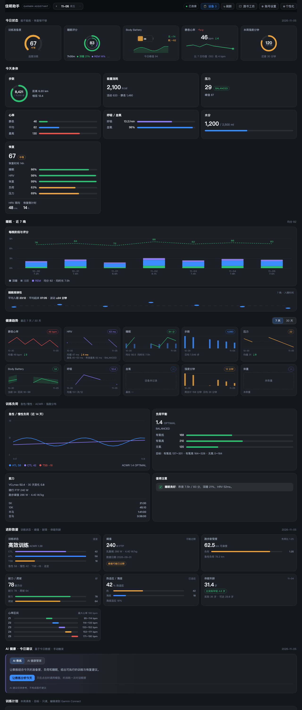
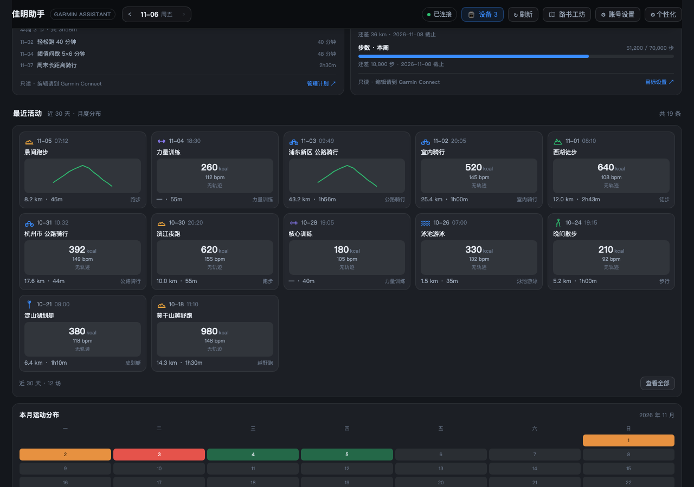
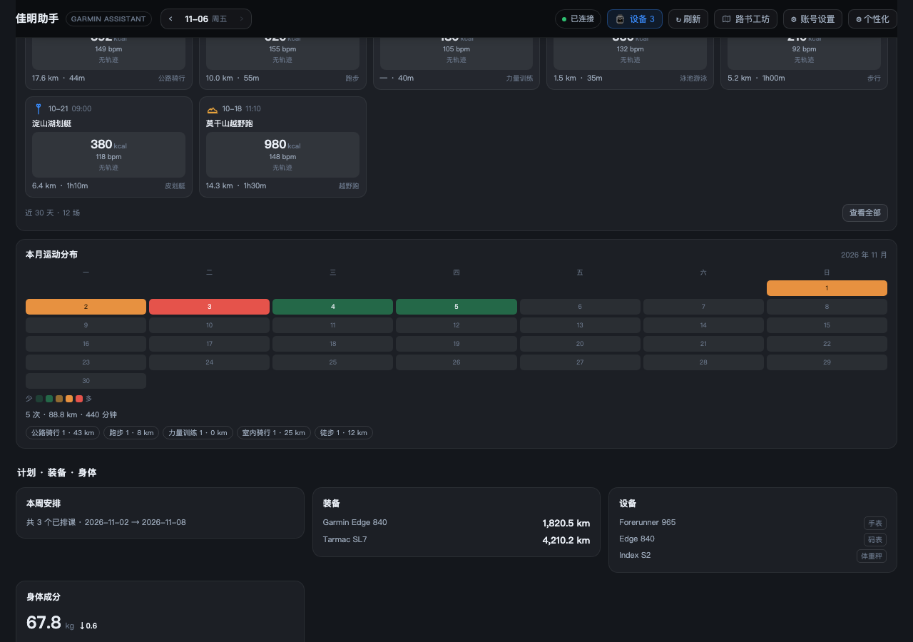
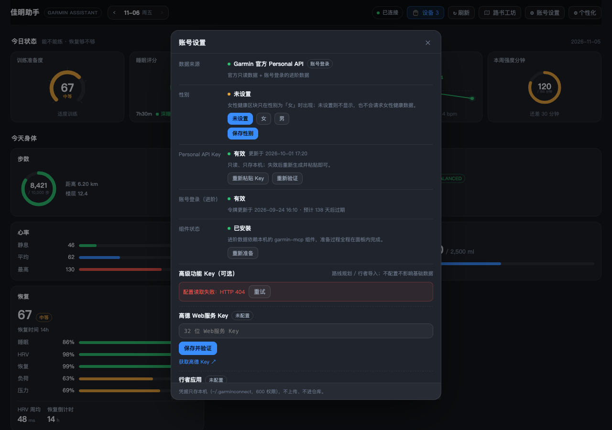
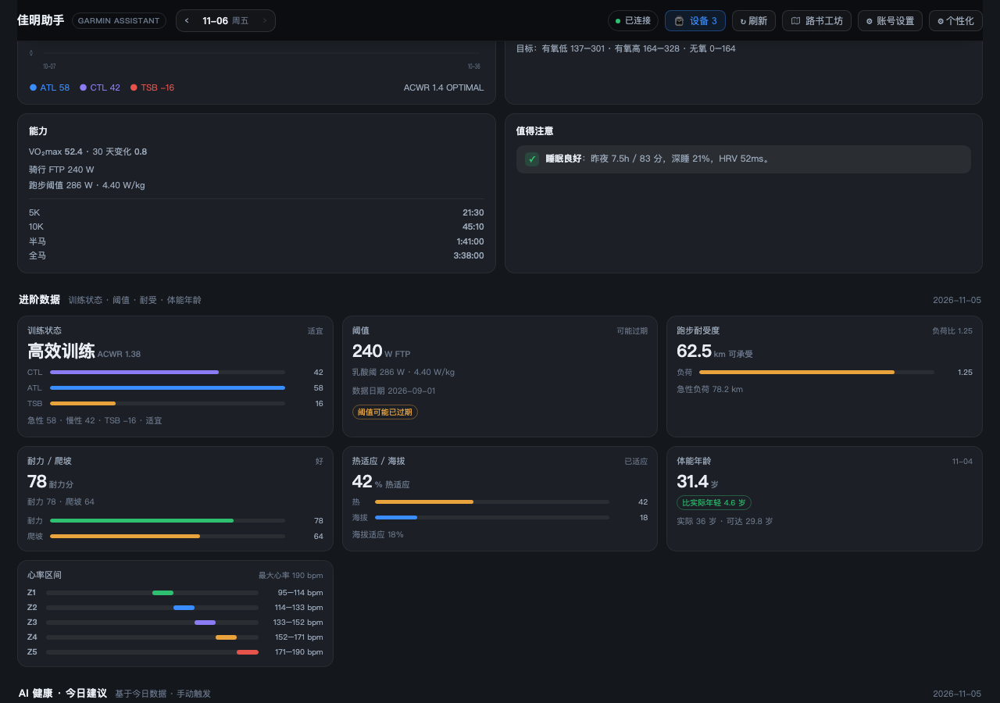
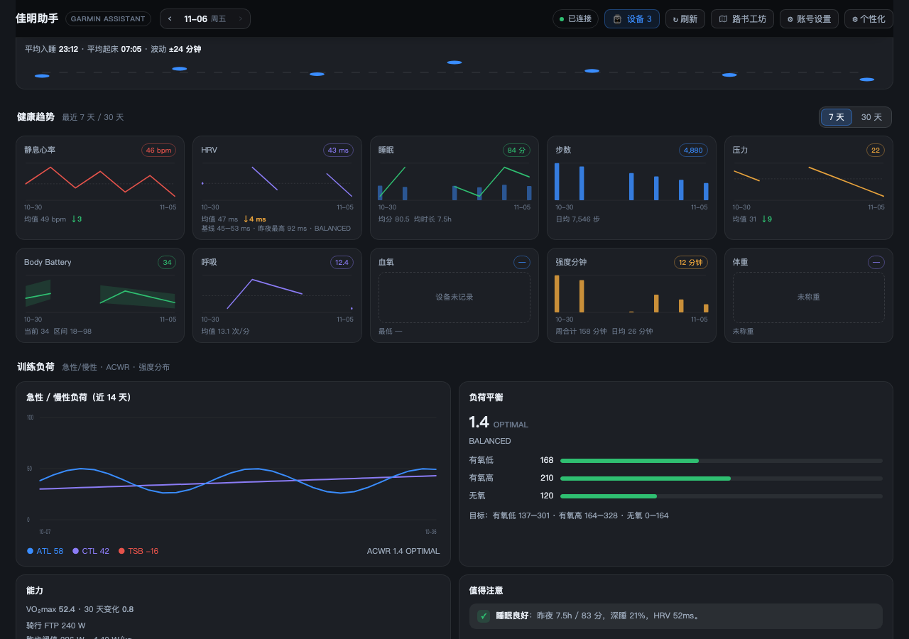
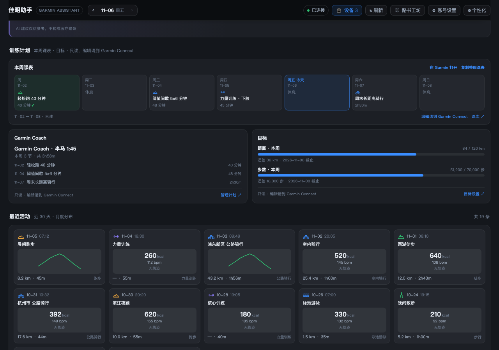
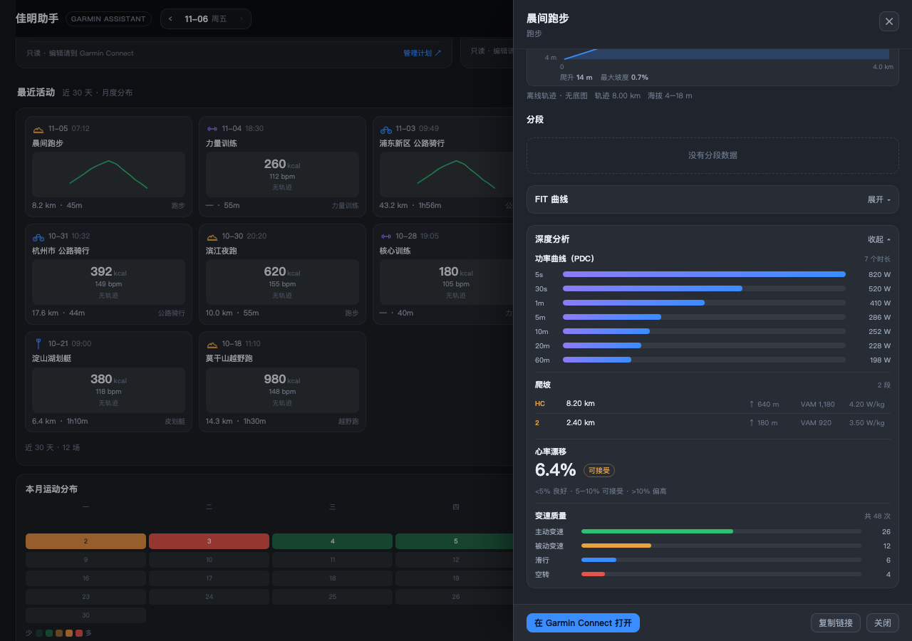

# 佳明助手 · Garmin Assistant for DeepSeek Harness

[](LICENSE)
[](https://github.com/zeelinkCN/dsh-garmin-assistant/releases)
[](https://github.com/zeelinkCN/dsh-garmin-assistant)
[](https://github.com/zeelinkCN/dsh-garmin-assistant)


> 把 Garmin Connect 的数据变成 Harness 里的一个常驻面板：今天能不能练、睡得好不好、负荷高不高、最近骑了哪，一眼看完；还能叫 AI 教练/健康管家给建议。



| | |
|---|---|
|  |  |
|  |  |

> **这是 DeepSeek Harness 桌面版的插件**，不是通用 MCP 服务，也不是 Garmin 官方应用。
> 数据默认走 **Garmin 官方 Personal API**（只读、免费、无需密码）；训练负荷等官方未开放的指标，可在面板里一键解锁「账号登录」模式（组件自动下载，不需要开终端）。

---

## ⚠️ 适用范围（先看这个）

| 项目 | 要求 |
|---|---|
| 客户端 | **仅 DeepSeek Harness 桌面版 0.2.x**（使用其 Cordis 插件体系 + `ctx.webServer` + 浏览器模块加载） |
| 未验证 | DSH Web/CLI、其他版本、其他 AI 客户端（Claude Desktop 等）**都不在验证范围内** |
| 系统 | macOS 已实机验证；Windows 安装器已做平台分支（PowerShell 安装 uv + `.exe` 路径），**尚未在 Windows 实机验证**；Linux 未测试 |
| 账号 | 你自己的 Garmin 账号（国际版或中国区均支持） |

---

## 数据从哪来（两档）

### 默认：Garmin 官方 Personal API（推荐，零门槛）
- 在 Garmin Connect 网页版「设置 → Personal API」创建一个 Key（约 8 秒），粘进面板即可
- 只读、免费、不经过密码；Key 存本地 `~/.garmin-personal-key`（权限 600），24 小时令牌自动续期
- 覆盖：睡眠（评分/分期/HRV/静息心率）、Body Battery、压力、呼吸、血氧、水分、步数/卡路里/楼层、心率区间、活动列表与活动详情、原始 FIT 下载、体重、营养、体能年龄

### 进阶：Garmin 账号登录（可选，面板内一键准备）
官方 Personal API 没有开放这些指标：
训练负荷（CTL/ATL/ACWR）、训练准备度、VO₂max 趋势、比赛预测、装备、训练计划。
想看的话，在面板里点「解锁进阶数据」——面板会**自动**在后台准备所需组件（不需要开终端），然后让你用 Garmin 账号密码（含两步验证）登录一次。不点就完全不会下载任何东西。

---

## 功能

- **今日状态**：训练准备度（进阶）、睡眠评分、Body Battery、静息心率、本周强度分钟
- **今天身体**：步数环、卡路里、压力、心率、呼吸、血氧、水分、楼层
- **恢复**：准备度 6 因子分解、HRV 周均、恢复倒计时（进阶）
- **睡眠近 7 晚**：深/浅/REM/清醒堆叠柱 + 评分折线
- **健康趋势**：7 天 / 30 天切换，10 类指标（静息心率、HRV、睡眠、步数、压力、Body Battery、呼吸、血氧、强度分钟、体重）
- **更多身体细节**：心率区间（Z1–Z5）、睡眠规律性（平均入睡/起床/波动）、身体成分（体脂/肌肉/骨量/水分/BMI）、HRV 基线、Body Battery 日内曲线
- **活动深度**：详情补充训练负荷/最大速度/海拔区间/有氧无氧评级/设备、力量训练组次表、FIT 曲线（心率/功率/踏频/速度/海拔/温度）
- **训练计划**（进阶，只读）：本周课表、Garmin Coach、目标进度；左键看详情、右键/图标复制、整周复制，编辑与排课跳转 Garmin Connect
- **FIT 深度分析**（进阶）：功率曲线 PDC、爬坡 VAM/W/kg、心率漂移、电子变速分析
- **女性健康**（默认按性别显示）：周期概览、孕期摘要
- **训练负荷**：ATL/CTL 双线、ACWR、负荷平衡、VO₂max、阈值、比赛预测（进阶）
- **最近活动**：点开看详情——分段表、心率/功率区间、天气、装备、离线轨迹 + 海拔剖面、Garmin 网页深链
- **AI 教练**：基于当日数据给「今日结论 / 训练建议 / 恢复建议 / 风险提醒 / 明日安排」
- **AI 健康管家**：睡眠、HRV、压力、生活习惯（饮水/久坐/用眼/咖啡因/作息/饮食），正常时明确说「保持即可」


| | |
|---|---|
|  |  |

- **可选高级 Key**：新手引导第 3 步与「账号设置」里可填高德 Web服务 Key / 行者应用 ID+Secret（含状态、验证、清除、获取链接），不填不影响基础功能
- **日期回看**：顶栏 `‹ 11-05 周四 ›` 导航，可回看最近 30 天；今日状态/身体/睡眠/趋势/负荷/活动/AI 建议都按所选日期取数，带「回看」标识和「今天」一键回来
- **高德底图**：活动轨迹、路书预览/详情都画在高德静态地图上（WGS84→GCJ-02 校准），无 Key/失败自动回退 SVG
- **路书工坊**：我的路书（导入/预览/导出/重命名/改描述/复制/删除）、行者路书编号或 GPX 导入
- **AI 一句话生成路书**：自然语言 → 2–3 条候选（自动命名、距离/爬升/预计时间/难度、轨迹+海拔预览）→ 一键保存并高亮；地点歧义自动选优并可换地点
- **多日行程**：选 2–15 天 → 联网参考经典路线（可选）→ AI 拆天 + 高德逐日算路 → 一份行程 + N 条路书，支持整程保存/按日保存/行程分组管理
- **海拔图**：左右轴刻度（海拔/里程）、累计爬升、最大坡度、悬停查看「距离 · 海拔」
- **AI 营养建议**：按当天训练量/体重/睡眠给出热量与宏量（具体克数）、训练前后补给、饮水、注意事项（Garmin 营养是会员功能，这里用 AI 生成）
- **账号设置**：右上角常驻入口，可重新粘贴/验证 Key、重新登录账号、重新准备组件、刷新数据；授权过期时顶部有提示条
- **进阶数据区**（仅进阶模式）：训练状态、阈值、跑步耐受度、耐力/爬坡、热适应、体能年龄
- **今日状态图形化**：准备度弧形仪表、睡眠环+深睡/REM 图例、Body Battery 电池、静息心率 8 天迷你折线、强度分钟进度环
- **个性化（两级）**：点顶栏「⚙ 个性化」，区块可拖拽排序/隐藏/加回；每个区块内的卡片（共 23 张）也能单独隐藏、加回、在区块内拖动排序，本地记住
- **新手引导**：首次打开是三步向导（怎么拿 Key、粘贴验证、可选解锁进阶），面板内可随时「重看新手引导」
- **只读**：不改名、不排课、不删活动；写操作仍建议在对话里让 agent 执行

---

## 开发结构（v1.3.0 重构后）

```
dsh-garmin-assistant/
├── index.js            # Host 入口（20 行，只做装配）
├── host/               # Host 按职责拆分：config / official / mcp / llm / roadbook / routes / plugin
├── client.js           # 浏览器产物（自动生成，勿手改）
├── src/client/         # Client 源码分段：header/styles/utils/charts/sections/workshop/modals/app
└── scripts/
    ├── build-client.mjs      # 拼接 src/client/*.js → client.js（幂等、--check）
    └── check-fragments.mjs   # 每段语法检查
```

改 Client 代码：编辑 `src/client/*.js` 后运行 `npm run build:client`（或 `node scripts/build-client.mjs`），再 `node scripts/build-client.mjs --check` 确认产物最新。`client.js` 顶部有 `AUTO-GENERATED` 标记。

## 安装

### 前置
- DeepSeek Harness 桌面版 0.2.x

### 开发结构（v1.3.0 重构后）

```
dsh-garmin-assistant/
├── index.js            # Host 入口（20 行，只做装配）
├── host/               # Host 按职责拆分：config / official / mcp / llm / roadbook / routes / plugin
├── client.js           # 浏览器产物（自动生成，勿手改）
├── src/client/         # Client 源码分段：header/styles/utils/charts/sections/workshop/modals/app
└── scripts/
    ├── build-client.mjs      # 拼接 src/client/*.js → client.js（幂等、--check）
    └── check-fragments.mjs   # 每段语法检查
```

改 Client 代码：编辑 `src/client/*.js` 后运行 `npm run build:client`（或 `node scripts/build-client.mjs`），再 `node scripts/build-client.mjs --check` 确认产物最新。`client.js` 顶部有 `AUTO-GENERATED` 标记。

## 安装插件

```bash
git clone https://github.com/zeelinkCN/dsh-garmin-assistant.git
dsh plugin --profile desktop add ./dsh-garmin-assistant
```

首次打开面板会进入向导：按提示在 Garmin 官网创建 Personal API Key → 粘贴 → 开始使用。

> 不想用 key？向导里也提供「账号密码登录」入口（即进阶模式）。

---

## 隐私与安全

- **默认模式下没有任何密码**：只有一个只读的 Personal API Key，存本地 600 权限文件，不上传、不进仓库、不写日志。
- 进阶模式下密码只在本机通过管道传给登录进程，不落盘、不写日志。
- 插件无遥测、无第三方请求；HTTP 路由只在本机回环地址上、与 Harness 同源。
- 所有 Garmin 请求都由你自己的机器直接发往 Garmin。

---

## 已知限制

- Host 半改动需要重启 Harness；Client 半 500ms 内热更新。
- 官方 API 的区间端点有 28/31 天上限。
- 数据缺口（未称重、设备未记录血氧）显示空态，不补 0。
- 官方模式下活动详情没有分段/区间/天气，轨迹需要进阶模式（后续会改为本地解析 FIT）。
- 进阶模式的组件在用户点击「自动准备并登录」时才会在后台下载，默认不占空间。
- 一个面板对应一个 Garmin 账号。

---

## 目录结构

```
.
├── index.js            # Host：官方 Personal API 客户端 + 可选 MCP 后端 + 所有 HTTP 路由 + 登录/安装流程
├── client.js           # Client：浏览器 React 模块（免构建），面板/向导/教练/个性化
├── package.json        # dsh.bundle.patch + dsh.client 声明
├── cordis.patch.yml    # 安装时插入的 loader 行
├── icon.svg            # Garmin Connect 风格图标（原创，非官方）
├── locale/             # 插件标题/描述（中/英）
└── docs/               # 设计说明、截图
```

---

## License

MIT。见 [LICENSE](LICENSE)。

Garmin、Garmin Connect 是 Garmin Ltd. 的商标；本项目为第三方开源项目，与 Garmin 无关联。AI 建议仅供参考，不构成医疗建议。
